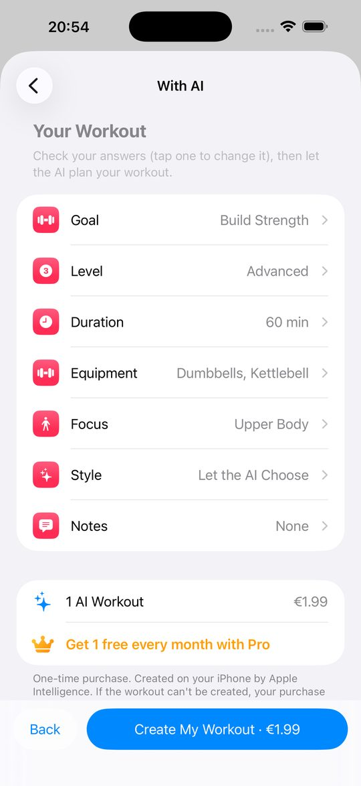

# AI Workouts

Answer 7 questions and Apple Intelligence plans a complete workout for you, directly on your device.

On this page

* TOC
{:toc}

## How it works

<figure class="screen right"><figcaption>The summary before creating</figcaption></figure>

AI workouts are generated by **Apple Intelligence**, the on-device model built into iOS. Your answers never leave your device: they are not sent to the developer or to any server.

The result is a normal workout with a warm-up, main parts and a cool-down, saved in your library. You can rename, move, duplicate, export and start it like any other workout. Editing its blocks requires [Pro](pro.html).

## Requirements

| Requirement | Details |
|---|---|
| A compatible device | iPhone 15 Pro or newer, or an iPad with Apple Intelligence. |
| Apple Intelligence turned on | In the Settings app › **Apple Intelligence & Siri**. |
| The model is downloaded | Right after you turn Apple Intelligence on, the device downloads it. This can take a few minutes, on Wi-Fi and while charging. |
| A supported language | The language of your device (and Siri) must be supported by Apple Intelligence. |

If one of these is missing, **With AI** shows **Apple Intelligence Needed** with the reason:

| Message | What to do |
|---|---|
| *AI workouts are created on your iPhone by Apple Intelligence, which needs an iPhone 15 Pro or newer.* | This device can't create AI workouts. Use templates, or create the workout on a compatible device and [export it](import-export.html). |
| *Turn on Apple Intelligence in the Settings app (Apple Intelligence & Siri), then come back here.* | Turn it on, then try again. |
| *Apple Intelligence is still getting ready on this iPhone. Please try again in a few minutes.* | Wait for the download to finish (Wi-Fi, charging). |
| *Apple Intelligence is not available right now. Please try again later.* | Try again later. |

## Create an AI workout

1. Open the folder where you want the workout, tap **⋯ › Create a Workout › With AI**.
2. Answer the questions. Each answer is a list of choices; tap one, then **Continue**. The progress is shown at the top (*Question 3 of 7*). Use **Back** to go to the previous question.
3. Check the **summary** (*Your Workout*). Tap any line to change that answer; **Done** brings you back to the summary.
4. Tap **Create My Workout**. If you need to pay, the price is written on the button (*Create My Workout · €1.99*) and Apple's purchase sheet opens first.
5. *Creating your workout… Apple Intelligence is planning your workout. This can take a few seconds.*
6. When it's ready: **“Workout name” Created**, *Saved in My Workouts › Folder*. Tap **Done**.

## The 7 questions

### 1. What's your goal?
*Your workout is built around it.*

| Choice | Meaning given to the AI |
|---|---|
| **Build Strength** | build strength |
| **Burn Fat** | high-energy conditioning that raises the heart rate |
| **Improve Endurance** | improve cardio endurance |
| **Mobility & Flexibility** | improve mobility and flexibility |
| **Stay Fit** | general fitness |

### 2. What's your level?
*So the workout is challenging, but not too hard.*

| Choice | Description |
|---|---|
| **Beginner** | New to training, or coming back after a break. |
| **Intermediate** | Training regularly for a few months. |
| **Advanced** | Training hard for years. |

### 3. How much time do you have?
*Warm-up and cool-down included.* Choose **10, 15, 20, 30, 45 or 60 min**.

### 4. What equipment do you have?
*Choose everything you have. Only these will be used.* You can choose several:

**No Equipment** · **Dumbbells** · **Kettlebell** · **Pull-up Bar** · **Resistance Bands** · **Jump Rope**

*No Equipment* can't be combined with the others: choosing it clears the rest, and choosing a piece of equipment clears *No Equipment*.

### 5. What do you want to work on?
*The muscles or the kind of effort.* **Full Body**, **Upper Body**, **Lower Body**, **Core & Abs** or **Cardio**.

### 6. Which kind of training?
*The discipline your workout is inspired by.*

| Choice | Description |
|---|---|
| **Let the AI Choose** | The best style for your goal. |
| **Bodybuilding** | Strength exercises to build muscle. |
| **Street Workout** | Bodyweight strength: push-ups, pull-ups, dips… |
| **CrossFit** | Intense and varied functional movements. |
| **Cross Training** | A mix of strength and cardio. |
| **Combat Sports** | Boxing, MMA and martial arts conditioning. |
| **Athletics** | Speed, power and running drills. |
| **Pilates** | Controlled core and posture work. |
| **Yoga** | Poses and flows for strength and flexibility. |

### 7. Anything else? (optional)

A free text. *Describe your level and your recent training very precisely: what you do, how often and for how long. Otherwise, the workout may not be suited to you.*

Example: *I run twice a week, I can do 15 push-ups in a row, I stopped training 3 months ago…*

Leave it empty and tap **Skip** if you have nothing to add.

<blockquote class="tip" markdown="1">

**Tip:** precise notes give much better workouts. Mention injuries or movements to avoid, your current numbers (push-ups, running pace…) and how often you train.

</blockquote>

## What the AI creates

- A **name** of 2 to 4 words and a **one-sentence description**.
- **2 to 5 parts** in order: a warm-up, the main parts, and a cool-down. Each part becomes a [group](creating-workouts.html#groups), repeated for **1 to 10 rounds**.
- **1 to 6 exercises** per part. Each exercise is **timed** (10 s to 5 min) and has a short **coaching cue** (shown on the timer). A rest can follow an exercise, and a part can have a rest between rounds.
- The total is adjusted to the **duration you chose**: if the AI's plan is more than 15% too short or too long, every time is scaled, rounded to 5 seconds (between 5 s and 10 min per block).

The workout is saved in the folder where you started, with a unique name (a number is added if the name is already used there).

## Price and access

There are three ways to pay for an AI workout. The app always uses them in this order:

| Situation | What you see in the summary | What is used |
|---|---|---|
| You have **Pro** and haven't used this month's free AI workout | 👑 *Free this month with Workout Planner Pro* | The free AI workout of the month |
| You have AI workouts left from earlier purchases | *You have 2 AI workouts left* | One of them |
| Otherwise | **1 AI Workout** and its price, plus *Get 1 free every month with Pro* if you don't have Pro | A one-time purchase |

Good to know:

- **You only pay for a workout that is created.** If creation fails, nothing is used: *If the workout can't be created, your purchase is kept for the next try.* The workout you paid for stays available until it is created.
- **The free AI workout of Pro is per calendar month** (from the 1st to the last day of the month). It doesn't carry over to the next month.
- On the 1st of each month, Pro subscribers get a [notification](notifications.html) and, when they open the app, a pop-up **Your Free AI Workout** with **Create It** and **Later**.
- **Ask to Buy**: if a parent must approve the purchase, the app says *Your purchase is waiting for approval. You can create your workout once it is approved.*
- AI workouts you bought are **consumable purchases**: unused ones are stored on your device and can't be restored with *Restore Purchases*. Use them before deleting the app.
- In France the price is €1.99 per AI workout. Prices depend on your country and are always shown before you pay.

## When something goes wrong

If Apple Intelligence can't create the workout, the app shows the reason, *Nothing was used: you can try again, or change your answers.*, and two buttons: **Try Again** and **Change My Answers**.

| Message | What it means / what to do |
|---|---|
| *Apple Intelligence declined to create this workout. Try other answers (another goal or training style), or remove your notes.* | The model refused this combination. Change the goal, the style or the notes. |
| *The safety filter of Apple Intelligence blocked this request. Try other answers, or remove your notes.* | Some words triggered Apple's filter, often in the notes. Rephrase or remove them. |
| *This workout was too long for Apple Intelligence. Try a shorter duration.* | Choose a shorter duration. |
| *Apple Intelligence doesn't support the language of this iPhone.* | Use a language supported by Apple Intelligence. |
| *Apple Intelligence is still getting ready on this iPhone. Please try again in a few minutes.* | The model is still downloading. |
| *Apple Intelligence is busy. Please try again in a moment.* | Try again a bit later. |
| *Apple Intelligence couldn't finish this workout.* | Try again, or change your answers. |

Behind the scenes, the app already tries several phrasings of your request before showing an error, so a refusal is rare.

## Tips for better AI workouts

- Be honest about your **level**: *Advanced* workouts are long and intense.
- Pick only the **equipment** you really have with you.
- Use the **notes** for anything specific: injuries, movements to avoid, the sport you are preparing for.
- Don't like a detail? With [Pro](pro.html) you can edit the generated workout like any other.
