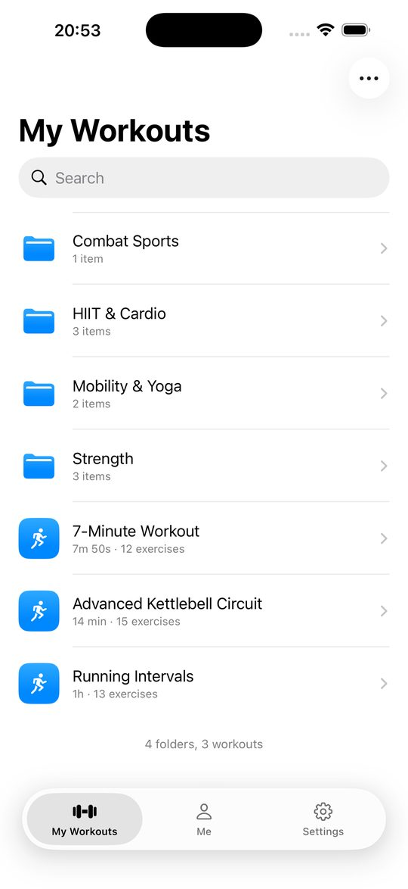
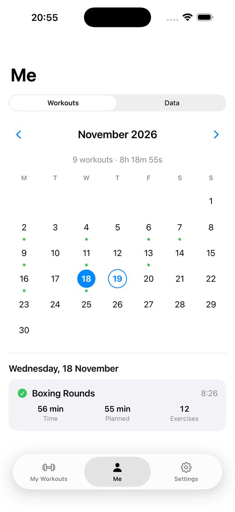
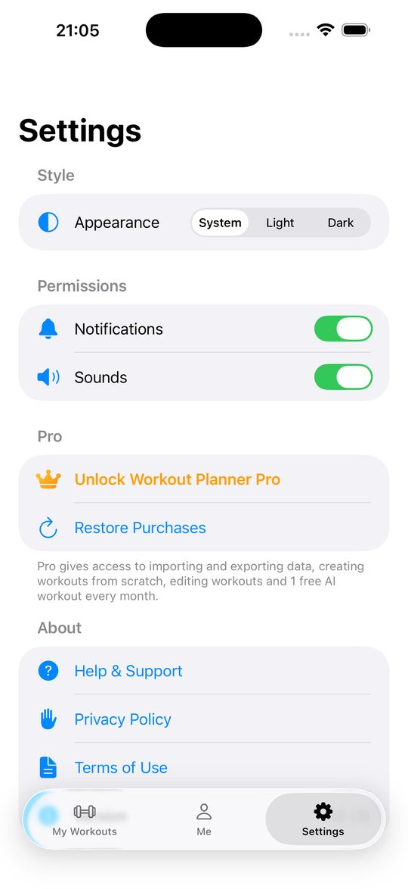

# Getting Started

Install the app, find your way around the three tabs, and play your first workout in two minutes.

On this page

* TOC
{:toc}

## Requirements

| | |
|---|---|
| Devices | iPhone and iPad |
| System | iOS 26.5 or later, iPadOS 26.5 or later |
| Language | English |
| Account | None. There is no sign-up and no login. |
| Internet | Not needed to use the app. Only needed to buy or restore purchases on the App Store. |
| AI workouts | A device with Apple Intelligence turned on: iPhone 15 Pro or newer, or an iPad with Apple Intelligence. See [AI Workouts](ai-workouts.html). |

## Install the app

Download Workout Planner from the [App Store]({{ site.app_store_url }}). The app itself is free. Some features are part of [Workout Planner Pro](pro.html), and AI workouts can be bought one by one.

## The first launch

1. A short splash screen appears with the app logo.
2. The **Workout Planner Pro** screen is shown **once**, to present what Pro unlocks. You don't have to subscribe: close it with the **✕** button at the top right to use the app for free. You can open it again at any time from **Settings › Unlock Workout Planner Pro**.
3. The first time the app needs it, iOS asks whether Workout Planner may send **notifications**. They are used for two gentle daily reminders. You can say no, and change your mind later. See [Notifications](notifications.html).

## The three tabs

The tab bar floats at the bottom of the screen. It slides away while you scroll down a list, and comes back when you scroll up or tap a tab.

  <figure class="screen"><figcaption>My Workouts</figcaption></figure>
  <figure class="screen"><figcaption>Me</figcaption></figure>
  <figure class="screen"><figcaption>Settings</figcaption></figure>

| Tab | What you find there |
|---|---|
| **My Workouts** | All your workouts, stored in folders like in the Files app. You create, organize and start workouts here. See [Organizing Workouts](organizing-workouts.html). |
| **Me** | **Workouts**: a calendar of every workout you completed. **Data**: weekly and monthly charts, averages and totals. See [History & Statistics](history-and-statistics.html). |
| **Settings** | Appearance, notifications, sounds, Workout Planner Pro, help and legal links. See [Settings](settings.html). |

Each tab keeps its place: if you open a folder in My Workouts, switch to Me and come back, you are still in that folder.

## Your first workout in two minutes

1. In **My Workouts**, tap the **⋯** button at the top right, then **Create a Workout**.
2. Choose **From a Template**.
3. Tap **Tabata**. The workout is created right away in the current folder (here, at the root of My Workouts).
4. Tap the new **Tabata** workout to open it. You see its description, its duration (4 min), and its program: a group named *Tabata* repeated **×8** with *Work* 20 s and a *Rest* of 10 s.
5. Tap **Start Workout**. A 5-second **Get Ready** countdown starts, then the timer plays the 16 steps one after the other, with a beep at each change.
6. At the end, the **Workout Complete!** screen shows the time and the number of exercises. Tap **Done**: the workout now appears in **Me › Workouts** and in your statistics.

<blockquote class="tip" markdown="1">

**Tip:** you don't need to open a workout to start it. In any list, **touch and hold** a workout and choose **Start Workout**. You can also start a workout from the Home Screen with the [Quick Start widget](widgets.html).

</blockquote>

## Want ready-made workouts?

With [Pro](pro.html), you can import a whole library of example workouts in one go: download [example-workouts.json](downloads/example-workouts.json) (11 workouts in 4 folders: HIIT & Cardio, Strength, Combat Sports, Mobility & Yoga, plus *7-Minute Workout* and *Running Intervals*), then in My Workouts tap **⋯ › Import Data** and choose the file. See [Import & Export](import-export.html).

## Where next?

- Build your own workouts: [Creating & Editing Workouts](creating-workouts.html)
- Let Apple Intelligence plan one for you: [AI Workouts](ai-workouts.html)
- Everything about the timer screen: [Running a Workout](timer.html)
