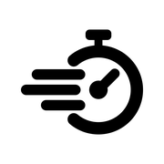

  
  
  

    <h1>Workout Planner</h1>
    
Plan and time your workouts. Complete user guide.

  

Workout Planner is an interval timer and workout planner for iPhone, iPad and Apple Watch. You build workouts out of **exercises**, **rests** and **groups** repeated for several rounds, keep them in **folders** like in the Files app, and play them with a large full-screen **timer** that beeps, talks, counts down and keeps running on the Lock Screen — or on your **Apple Watch**, with your heart rate and calories. Every completed workout goes into your **history**, **statistics** and **goals**.

Everything stays on your device: no account, no ads, no tracking.

<a class="button" href="{{ site.app_store_url }}">Download on the App Store</a> <a class="button secondary" href="getting-started.html">Get started</a>

  
  
  

## The user guide

  <a class="card" href="getting-started.html"><strong>Getting Started</strong>Requirements, the three tabs, and your first workout in two minutes.</a>
  <a class="card" href="organizing-workouts.html"><strong>Organizing Workouts</strong>Folders, search, sort, rename, duplicate, move, select and delete.</a>
  <a class="card" href="creating-workouts.html"><strong>Creating &amp; Editing</strong>Templates, workouts from scratch, exercises, rests and nested groups.</a>
  <a class="card" href="ai-workouts.html"><strong>AI Workouts</strong>Answer 7 questions and Apple Intelligence plans a workout for you.</a>
  <a class="card" href="timer.html"><strong>Running a Workout</strong>The timer screen, controls, beeps, the voice coach, the Lock Screen and the end of a workout.</a>
  <a class="card" href="history-and-statistics.html"><strong>History &amp; Statistics</strong>Calendar, workout details, charts, goals, profile, heart rate and calories.</a>
  <a class="card" href="apple-watch.html"><strong>Apple Watch</strong>Workouts on your wrist, heart rate, calories and a watch face complication.</a>
  <a class="card" href="widgets.html"><strong>Widgets &amp; Live Activity</strong>Quick Start, Stats and Goals widgets, the Dynamic Island and the Lock Screen.</a>
  <a class="card" href="notifications.html"><strong>Notifications</strong>Daily reminders, goal reminders and the monthly free AI workout reminder.</a>
  <a class="card" href="pro.html"><strong>Workout Planner Pro</strong>What Pro unlocks, plans, cancelling, restoring purchases.</a>
  <a class="card" href="import-export.html"><strong>Import &amp; Export</strong>Share workouts as files, and the complete JSON file format.</a>
  <a class="card" href="settings.html"><strong>Settings</strong>Every option of the Settings tab, one by one.</a>
  <a class="card" href="faq.html"><strong>FAQ &amp; Troubleshooting</strong>Answers to the most common questions and problems.</a>

## Features at a glance

| Feature | Free | With Pro |
|---|:---:|:---:|
| Folders and sub-folders, search, sort, rename, duplicate, move, delete | ✓ | ✓ |
| Create workouts from 8 ready-made templates (Tabata, EMOM, AMRAP, HIIT…) | ✓ | ✓ |
| AI workouts made by Apple Intelligence | Pay per workout | **1 free every month**, then pay per workout |
| Full-screen timer with beeps, voice coach, haptics and Live Activity | ✓ | ✓ |
| History calendar, workout details, charts, averages, totals, shareable images | ✓ | ✓ |
| Goals with progress bars (workouts, time, exercises or calories per week, month, year or between two dates) and reminders | ✓ | ✓ |
| Profile (name, sex, birthday, height, weight) | ✓ | ✓ |
| Quick Start, Stats and Goals widgets | ✓ | ✓ |
| Completed workouts saved in **Apple Health** | ✓ | ✓ |
| Create a workout **from scratch** | – | ✓ |
| **Edit** any workout (blocks, durations, groups) | – | ✓ |
| **Import** workouts and folders from `.json` files | – | ✓ |
| **Export** workouts and folders as `.json` files | – | ✓ |
| **Apple Watch app**: play workouts, heart rate, calories, complication | – | ✓ |

See [Workout Planner Pro](pro.html) for the details.

## How a workout is built

A workout is a list of **blocks**. There are three kinds of blocks:

- Exercise a name, an optional description (a coaching cue) and a duration.
- Rest a duration.
- Group a list of blocks repeated for a number of **rounds** (1 to 99). A group can contain other groups, so you can build nested loops such as *2 blocks of 8 Tabata rounds with 1 minute of rest between the blocks*.

When you start a workout, the timer "unrolls" the groups into a simple list of timed steps and plays them one after the other. Read more in [Creating & Editing Workouts](creating-workouts.html).

## Requirements

- An **iPhone** or **iPad** with **iOS 26.5 / iPadOS 26.5 or later**.
- For the [Apple Watch app](apple-watch.html) (Pro): an Apple Watch with **watchOS 26.5 or later**, paired with your iPhone.
- For [AI workouts](ai-workouts.html) only: a device with **Apple Intelligence** turned on (iPhone 15 Pro or newer, or an iPad with Apple Intelligence).
- The app is in **English**.

## Need help?

Read the [FAQ](faq.html), or write to [{{ site.contact_email }}](mailto:{{ site.contact_email }}). Answers usually within 48 hours. See also the [Support](support.html) page and the [Privacy Policy](privacy.html).
