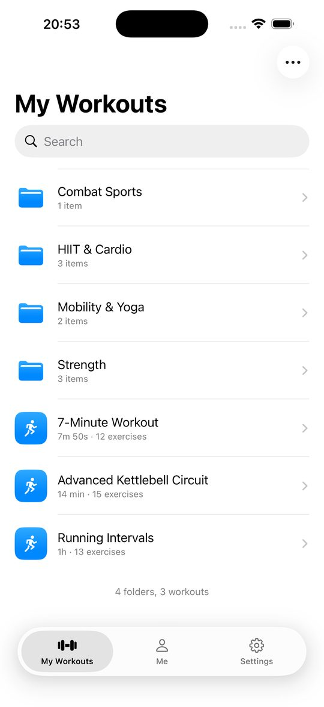
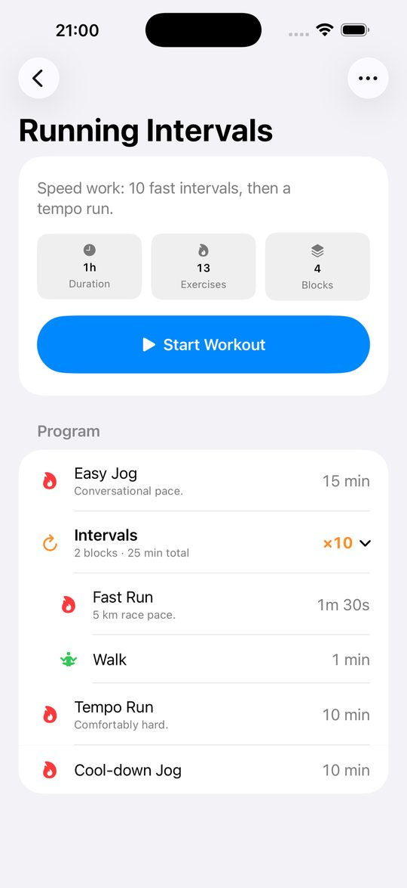

# Organizing Workouts

The My Workouts tab works like the Files app: folders inside folders, with your workouts inside them.

On this page

* TOC
{:toc}

<figure class="screen right"><figcaption>The root of My Workouts</figcaption></figure>

## The library

The top level of the tab is called **My Workouts**. It can contain:

- **Folders**, shown with a blue folder icon, their name, and the number of items they contain (`3 items`). A folder can contain other folders, with no depth limit.
- **Workouts**, shown with their name, total duration and number of exercises (`1h · 13 exercises`).

Folders are always listed **before** workouts. At the bottom of the list, a summary line counts what the current folder contains, for example `4 folders, 3 workouts`.

Tap a folder to open it, and use the back button (or swipe from the left edge) to go back. Tap a workout to open its [detail page](#the-workout-page).

When a folder is empty, the page shows **No Workouts** (at the root) or **Empty Folder**, with a hint to use the menu.

## The ⋯ menu

Every folder page has a **⋯** button at the top right. It contains every action for the folder you are in:

| Section | Action | What it does |
|---|---|---|
| Add | **Import Data** Pro | Imports `.json` files into this folder. See [Import & Export](import-export.html). |
| | **Create a Workout** | Opens *Create a Workout*: from a template, from scratch Pro, or with AI. See [Creating Workouts](creating-workouts.html). |
| | **Add a Folder** | Asks for a name and creates a folder here. |
| Organize | **Select** | Turns on [selection mode](#selecting-several-items) to act on several items at once. |
| | **Sort By** | **Name** or **Date Created**. See [Sorting](#sorting). |
| This folder (not at the root) | **Rename Folder** | Renames the folder you are in. |
| | **Export Folder** Pro | Shares the folder and everything inside as one `.json` file. |
| | **Delete Folder** | Deletes the folder you are in and **everything inside it**, after a confirmation. |

Without Pro, Pro actions appear with a gold crown. Tapping them opens the Workout Planner Pro screen.

## Folders

### Create a folder

**⋯ › Add a Folder**, type a name, then **Create**. The folder is created inside the folder you are currently in.

- If you leave the name empty, the folder is called **New Folder** (or *New Folder 2*, *New Folder 3*… if that name is already used here).
- If another folder of the same folder already has this name, an alert **Name Already Used** explains it, and nothing is created.

### Names must be unique

Inside one folder, two folders can't have the same name, and two workouts can't have the same name. Upper and lower case and spaces at the start or the end don't count: `Leg Day`, `leg day` and `Leg Day ` are the same name. A folder and a workout may share a name.

The app checks this rule whenever you create, rename, move or save something. When items are **imported** or **duplicated**, the app never refuses: it picks a free name automatically (see [Duplicate](#duplicate) and [Import](import-export.html#what-happens-during-an-import)).

## Actions on one item

**Touch and hold** a folder or a workout to open its menu.

### Folder menu

| Action | What it does |
|---|---|
| **Rename Folder** | Opens a field with the current name. **Save** to apply. |
| **Duplicate Folder** | Copies the folder and its entire content (sub-folders and workouts) next to the original. |
| **Move Folder** | Moves it into another folder. See [Move](#move). |
| **Export Folder** Pro | Shares the folder as a `.json` file. |
| **Delete Folder** | Deletes it and everything inside, after a confirmation. |

### Workout menu

| Action | What it does |
|---|---|
| **Start Workout** | Opens the timer right away. Greyed out when the workout lasts 0 seconds. |
| **Edit Workout** Pro | Opens the workout editor. |
| **Rename Workout** | Changes the name only. Free for everyone. |
| **Duplicate Workout** | Creates a copy next to the original. |
| **Move Workout** | Moves it into another folder. |
| **Export Workout** Pro | Shares it as a `.json` file. |
| **Delete Workout** | Deletes it after a confirmation. |

### Duplicate

The copy is placed in the same folder as the original and named **“Name copy 1”** (for example *Leg Day copy 1*). If *copy 1* already exists, the next free number is used (*copy 2*, *copy 3*…). Duplicating *Leg Day copy 1* gives *Leg Day copy 1 copy 1*. A duplicated folder contains copies of everything that was inside the original.

### Move

**Move Folder** / **Move Workout** opens a list of all your folders, indented like a tree, starting with **My Workouts** (the root).

- The folder where the item currently is shows **Current** and can't be chosen.
- A folder can't be moved into itself or into one of its own sub-folders: those destinations are greyed out.
- If the destination already contains an item with the same name, the move is refused with **Can't Move** and a message such as *A workout named “Leg Day” already exists in “Strength”.* Rename one of them first.

### Delete

Deleting always asks for a confirmation and **can't be undone**. Deleting a folder deletes all its sub-folders and workouts.

> Deleting a workout does **not** delete it from your history: the [history](history-and-statistics.html) keeps a copy of the workout's name for every completed session.

## Selecting several items

1. Tap **⋯ › Select**. The title becomes **Select Items**, and a circle appears in front of each row.
2. Tap rows to select them. The title shows the count (`3 Selected`).
3. Tap **⋯** for the selection actions:

| Action | What it does |
|---|---|
| **Done** | Leaves selection mode. |
| **Select All** / **Deselect All** | Selects or clears every row currently displayed (including search results). |
| **Export Data** Pro | Shares everything selected in **one** `.json` file. |
| **Duplicate Items** | Duplicates every selected item. |
| **Delete Items** | Deletes every selected item, after a confirmation (*Delete 3 items?*). |

If you select a folder and also a workout or folder that is inside it, the inner item is not counted twice: it comes with its folder.

> Moving works one item at a time, from the touch-and-hold menu.

## Search

The **Search** field sits under the title of every folder page. Type a few letters to search:

- in the **current folder and all its sub-folders** (at the root, that means everywhere);
- **folders** by name;
- **workouts** by name **or description**.

Results are grouped in two sections, **Folders** and **Workouts**. Each result shows where it is, for example `My Workouts › Strength`. Search ignores upper and lower case. If nothing matches, the page says so.

You can use selection mode on search results too.

## Sorting

**⋯ › Sort By** offers two orders:

| Order | Folders and workouts are sorted by |
|---|---|
| **Name** (default) | Name, in natural order: *Week 2* comes before *Week 10*. |
| **Date Created** | Creation date, newest first. |

The choice applies to **every folder** and is remembered. Folders always stay above workouts.

## The workout page

<figure class="screen right"><figcaption>A workout's page</figcaption></figure>

Tap a workout to open its page:

- The **description**, if the workout has one.
- Three tiles: **Duration** (total time, rounds included), **Exercises** (number of exercises actually performed, rounds included) and **Blocks** (number of top-level blocks).
- The big **Start Workout** button, greyed out if the workout lasts 0 seconds.
- **Program**: every block in order. Exercises show their description and duration; rests their duration; groups show **×N** (the number of rounds), the number of blocks they contain and their total time (`2 blocks · 25 min total`). Groups are folded at first: tap a group to unfold its content, and tap again to fold it.

The **⋯** button of this page contains: **Edit Workout** Pro, **Rename Workout**, **Export Workout** Pro and **Delete Workout**.

## Durations and exercise counts

The numbers shown everywhere follow the same rules:

- The duration of a group is **rounds × the duration of one round**.
- An exercise inside a group repeated 3 times counts as **3 exercises**.
- A folder's numbers include all its sub-folders.
- Durations are written like `45s`, `1m 30s`, `25 min`, `1h`, `1h 15m`.
