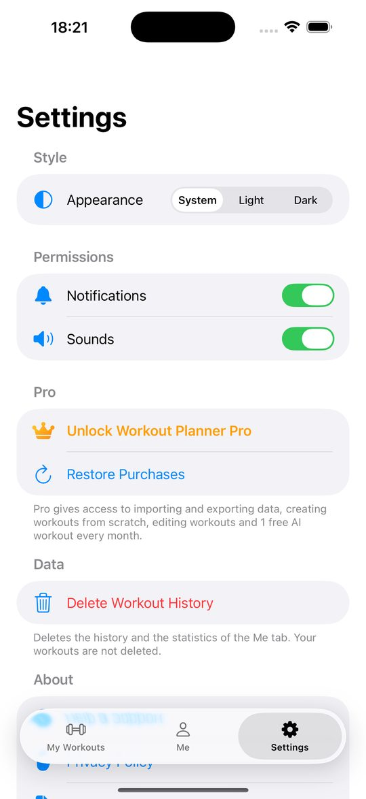

# Settings

Every option of the Settings tab, from top to bottom.

## Style

<figure class="screen right"><figcaption>Settings</figcaption></figure>

| Option | Choices | Effect |
|---|---|---|
| **Appearance** | **System** (default), **Light**, **Dark** | *System* follows the light or dark mode of your device. *Light* and *Dark* force one look in the whole app. The icon next to the option changes with your choice. |

## Permissions

| Option | Default | Effect |
|---|---|---|
| **Notifications** | On | Schedules the daily reminders at 7:00 and 22:00, and the monthly free AI workout reminder for Pro. Off removes them. Greyed out if notifications are not allowed for the app in iOS. See [Notifications](notifications.html). |
| **Sounds** | On | Plays the timer beeps: 3-2-1 countdown, start of an exercise, start of a rest, end of the workout. Off makes the timer silent (haptics still work). See [Running a Workout](timer.html#sounds). |

## Pro

Without Pro:

| Option | Effect |
|---|---|
| **Unlock Workout Planner Pro** | Opens the Pro screen with the plans. |
| **Restore Purchases** | Looks for an active Pro subscription on your Apple Account. |

With Pro:

| Option | Effect |
|---|---|
| **Workout Planner Pro — Active** | Shows that Pro is active. |
| **Manage Subscription** | Opens Apple's sheet to change plan or cancel. |
| **Restore Purchases** | Same as above. |

The footer reminds what Pro gives: importing and exporting data, creating workouts from scratch, editing workouts and 1 free AI workout every month. See [Workout Planner Pro](pro.html).

## Data

| Option | Effect |
|---|---|
| **Delete Workout History** | Deletes every completed workout: the calendar and the statistics of the **Me** tab are emptied. Your saved workouts are kept. Asks for a confirmation; can't be undone. Greyed out when the history is empty. |

See [History & Statistics](history-and-statistics.html#delete-your-history).

## About

| Option | Opens |
|---|---|
| **Help & Support** | The [Support](support.html) page |
| **Privacy Policy** | The [Privacy Policy](privacy.html) |
| **Terms of Use** | Apple's standard End User License Agreement (EULA) |
| **Version** | Shows the version and build of the app, for example *1.0 (3)*. Useful when you contact support. |

## Where the settings are stored

Settings are stored on your device with your workouts. They are not synced between devices.
